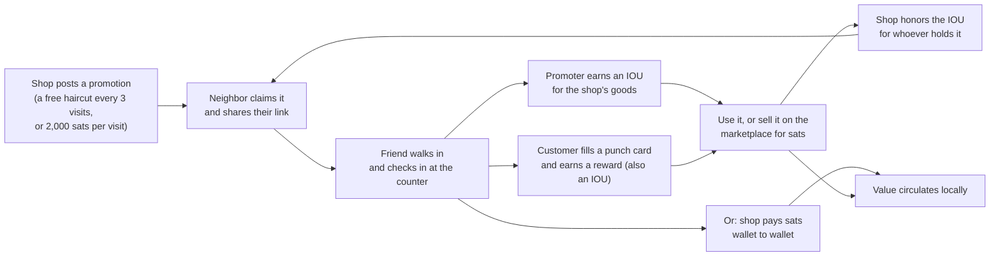

<!-- Generated by scripts/sync-white-paper.mjs. Edit business-docs/LocalWorx_White_Paper.md instead. -->

## Abstract

Bitcoin circular economies keep stalling on the same problem: merchants won't accept sats nobody spends, and people won't spend sats nobody accepts. Meanwhile, the marketing money local shops spend leaves town for ad platforms, and the customer relationship lives on servers neither the shop nor the customer controls.

LocalWorx breaks the loop from the business side. A shop pays local promoters for verified foot traffic — a customer who actually walked in, proven by a rotating code at the counter and the phone's location. It can pay in kind, with what it already makes (a meal, a haircut), as an IOU the promoter owns and can resell for sats. Or it can pay sats directly, or both. Either way, value reaches neighbors first, and spending follows.

Reciprocity holds it together. Every shop signs an explicit pledge to honor every IOU it issues, for whoever holds it. A shop that breaks that pledge carries a public badge until it makes things right.

The system is built on open protocols. Identity is a Nostr key that never leaves the user's device. Payments move wallet to wallet over Lightning, and LocalWorx never holds funds. Posts live on the Nostr network, not in our database. The code is public under GPLv3.

This paper sets out the problem, the model, the architecture, its limits, and an invitation to the creators who have spent years making the case for sound money and self-sovereignty: help us show it working, one town at a time.

---

## 1. The Extraction Problem

Value is created on Main Street and captured somewhere else.

- **Attention.** A shop's ad budget buys impressions from a few national platforms. Whether those impressions turn into a customer is the shop's problem.
- **Data.** Reviews, follower lists, and loyalty histories live inside platforms that can change the terms, raise the fees, or close the account.
- **Money.** Card fees, ad spend, and marketplace commissions flow out of the local economy with every sale.

The regulars who actually keep a shop alive — the ones who bring their friends — are paid nothing for it. They are the best marketing a business has, and they are invisible to every tool the business pays for.

We are all influencers to the people who matter most to us. The current system just doesn't pay us for it.

---

## 2. Why Bitcoin Circular Economies Stall

The Bitcoin community has run many circular-economy experiments. The ones that work usually share an unusual advantage: a dedicated local champion, outside funding, or a population with little access to banking. Most towns have none of these.

The standard pitch starts with the customer: *"spend your sats here."* That pitch fails on a chicken-and-egg problem:

1. A business has no reason to set up Lightning until customers arrive with sats.
2. Customers have no reason to spend sats until businesses accept them.
3. Bitcoiners, rationally, prefer to hold.

The result is Bitcoin as a savings account rather than an economy.

**LocalWorx changes the starting point.** A shop doesn't need customers paying in Bitcoin to begin. It doesn't even need sats. It only needs to pay neighbors for something it already wants — customers who walk in — and that it can verify, with whatever it has: its own goods or sats. Now value arrives in local hands as *income*, which people are far more willing to spend than savings. And because an IOU can be sold for sats on the marketplace, even a shop that never touches Bitcoin puts sats in motion between its neighbors.

---

## 3. The LocalWorx Model

### The loop

The arrow from "Shop honors the IOU" back to the promoter is the important one. A shop that keeps its word gets promoted again.

### Roles

| Role | What they do | What they get |
| --- | --- | --- |
| **Member** | Checks in at shops, fills punch cards | Rewards they own, can use, or can resell. Free. No wallet needed to start. |
| **Promoter** | Claims a shop's promotion and sends friends | Goods (an IOU they own and can resell), sats, or both, for verified visits. Paid by the shop directly. LocalWorx takes no cut. |
| **Business** | Lists the shop, signs the honor pledge, shows a counter code, sets rewards and promotions | Marketing it only pays for when customers actually walk in, and can pay for with its own goods |
| **Community** | Posts about the town, tips good posts | A local feed that lives on Nostr, not on a platform |

One account can hold every role. A barista can be a member at the bakery and a promoter for the bookstore.

### Paid in kind: IOUs as local currency

Most small shops have more product than cash. An ad platform wants cash. A neighbor will happily take a haircut.

So a LocalWorx promotion can pay in kind: *"one free haircut for every 3 customers you send."* When the third referred visit is verified, the promoter receives an IOU for that haircut. It's frozen at the terms it was issued under; the shop can't quietly change what it promised.

The IOU is the promoter's property:

- **Use it** at the counter like any reward.
- **Give it away** to a friend.
- **Sell it** on the LocalWorx marketplace for sats, wallet to wallet.

For the shop, a $12 haircut costs its cost of service, not $12 of cash. For the promoter, it's worth full retail, or whatever a neighbor will pay in sats. For the town, every resale moves sats between neighbors who may never have held any.

Shops that would rather settle in money can pay sats per visit instead, or combine the two.

### Rewards as property

Punch-card rewards work the same way. A filled card produces an IOU the member owns. They can redeem it once at the counter, or list it for sats. The buyer pays the seller's Lightning address directly, and ownership moves when the payment is verified. Unused value keeps circulating instead of expiring.

### Reciprocity: the honor pledge

An IOU is only worth the issuer's word. If people suspect a shop might refuse its IOUs, nobody will promote for it, nobody will buy its IOUs, and the loop stops.

So reciprocity is enforced in the product, not left to goodwill:

1. **An explicit pledge.** Before a shop can offer any punch card or promotion, its owner ticks a required checkbox: *honor every reward and IOU we issue, for whoever holds it, including someone who bought it on the marketplace; if we stop offering an item, give the holder something of equal value.*
2. **A way to report.** If a shop refuses an IOU, its holder taps "Shop won't honor this?" and says what happened. The shop sees the report right away.
3. **A window to make it right.** The shop has 7 days.
4. **A public badge.** If the report is still open after 7 days, the shop's page, its promotions and its marketplace listings show an **"Unpaid IOU"** badge.
5. **Only the holder closes it.** When the shop makes it right, the holder closes the report and the badge disappears. A shop marking the IOU "used" doesn't close it, so a shop can't clear its own badge.

This is the feedback loop that keeps people marketing for a shop consistently. Honor your IOUs and promoters come back. Refuse them and everyone in town can see it.

---

## 4. An Architecture of Sovereignty

The design rule is simple: **LocalWorx should not be able to steal your money, lock your account, or own your words — even if it wanted to.**

### 4.1 Identity: a key, not a login

There is no email and no password. A LocalWorx account is a Nostr keypair.

- The private key (nsec) **never leaves the device.** It can live in a browser extension (NIP-07), in encrypted storage on the device (NIP-49), in a phone signer such as Amber, or behind a remote signer (NIP-46).
- To sign in, the app requests a one-time challenge. The device signs it as a Nostr event (kind 27235, in the style of NIP-98). The server checks the signature, burns the challenge so it can't be replayed, and opens a session for that public key.
- Your LocalWorx identity is a standard Nostr identity, so it works in every other Nostr app. Leaving LocalWorx doesn't mean losing who you are.

**The server only ever sees signatures, never keys.**

### 4.2 Money: non-custodial by construction

LocalWorx holds no wallets, no balances, and no wallet secrets. No table, environment variable, or code path is allowed to store one.

- **Receiving:** users add a Lightning address (it looks like an email: `you@wallet.com`).
- **Paying:** users pay from their own wallet, or connect one through Nostr Wallet Connect (NWC).
- **Tips:** zaps (NIP-57), wallet to wallet.
- **Verification:** the server checks proof of payment (the payment preimage, or LUD-21 verification) before it marks a reward sale complete or a payout settled.

There is no LocalWorx balance to freeze, lose, or be hacked out of. The old version of LocalWorx used custodial wallets; v2 deliberately dropped them.

### 4.3 Content: published to the open network

Community posts are signed Nostr notes (kind 1) published to relays. LocalWorx shows them in a town feed, but it doesn't own them. If LocalWorx disappeared tomorrow, the posts would still exist, readable in any Nostr client.

### 4.4 Data: locked down by default

What LocalWorx does keep sits in a Postgres database where **every table has row-level security.** Every read and write is checked against the signed-in public key. Writes with business rules — recording a check-in, redeeming a reward, settling a sale — go through database functions that enforce them.

The rules aren't just written down; they're attacked. An automated suite runs the real migrations in an in-memory database and tries to break every permission rule (75 checks at the time of writing). It has to pass before any change ships. That includes the honor system: no one can file a report on an IOU they don't hold, write or close a report directly, or let a shop clear its own badge.

### 4.5 Code: open source

The full codebase is public under GPLv3 at [github.com/cleph01/localworx](https://github.com/cleph01/localworx). Anyone can check the claims in this paper against the code. Any community can run its own instance, and any improvement has to stay open.

### What LocalWorx knows, and doesn't

| LocalWorx stores | LocalWorx never has |
| --- | --- |
| Your public key and display name | Your private key |
| Your Lightning address, if you add one | Your funds, or any way to move them |
| Each check-in: which shop, when, and where your phone was at that moment | Your email, phone number, or contacts |
| Rewards and IOUs, promotions, and reward sales | Ad tracking or a data-sales business |
| Reports that a shop didn't honor an IOU (visible to the reporter and the shop; only a count and date are public) | |

Check-ins are visible to you and to the shop you checked in at. Not to other members.

---

## 5. Proof of Presence

Paying for foot traffic only works if a visit can't be faked from a couch. LocalWorx checks three things at once:

1. **A rotating counter code.** A tablet or old phone by the register shows a QR code that changes every 30 seconds. Each code is derived from a per-business secret (HMAC), so a photo of it is useless a minute later.
2. **Location.** The phone shares its location once, at check-in. It must be within the shop's radius (default 60 m, adjustable from 30 to 250 m).
3. **A time gap.** Each member can check in at a given shop once per gap (default 3 hours), so one visit can't be counted ten times.

Shops also approve which promoters can run their promotions, and they only pay for visits from people who came through that promoter's link. A promoter's own visits through their own link don't count.

None of this requires the shop to trust LocalWorx with money. It only has to trust that a check-in means a person was at the counter.

---

## 6. Small Costs Keep It Honest

"Free" platforms are paid for with ads and data, and they fill with bots because faking is free. LocalWorx puts a small, visible price on the few actions a bot would abuse and keeps everything else free.

| Who | Cost | Why |
| --- | --- | --- |
| Members | Free | Being a customer should never cost anything |
| Promoters | Free; keep 100% of payouts, in sats or in kind | Shops pay them directly |
| Tips and reward sales | No LocalWorx cut | It's your money |
| Community posts | Proposed: 1,000 sats or $1 by card (free now, 3 per day) | A bot can make a million free accounts. It can't pay a million posting fees. |
| Businesses | Proposed: modest monthly fee, **lower the more a shop pays local promoters**; free during pilots | Keeps listings to real shops, funds the work, and rewards shops that invest in their neighbors |

Every fee can be paid in sats or in dollars by card. LocalWorx earns from these small, open fees, so it never needs to sell anyone's attention or location.

The business fee is designed to fall as a shop pays more to neighbors. The incentive points one way: money for marketing should go to the community, not to us.

---

## 7. Limits and Open Questions

A white paper that only lists strengths isn't worth much. These are the hard parts.

- **Location data is sensitive.** Proof of presence means recording where a phone was at check-in. We store only that single point, show it only to the member and the shop, and never sell it. We are working on how long to keep it and whether a coarser record would do the same job.
- **Key loss is permanent.** If a member loses their device and never backed up their key, no one can recover the account — including us. That's the price of real ownership. We prompt for a backup at signup and support encrypted and remote signers, but education matters more than features here.
- **Lightning is still new to most shop owners.** We expect to onboard the first towns in person. A card option exists for anyone who doesn't want to touch Bitcoin yet.
- **Paid promotion must be disclosed.** US law (FTC) requires promoters to say they're paid. LocalWorx tags promotional posts automatically, and promoters are told to disclose too.
- **Moderation on an open network.** A Nostr post can't be deleted from the network. LocalWorx can only decide what its own town feed shows. Who makes that call, and how, is still open.
- **Regulation.** LocalWorx is non-custodial by design: it never receives, holds, or transmits user funds. We will still get legal review before any town launches.
- **Copycat listings.** Someone could list a well-known shop and collect its check-ins. A verified-business badge is required before the first pilot.
- **False reports.** A holder could claim a shop refused an IOU when it didn't. Only the IOU's current holder can report it, only once, and the shop sees the report at once. LocalWorx can dismiss reports shown to be false. How disputes are reviewed at scale is still open.
- **IOUs and the law.** Resellable IOUs may fall under gift-certificate or promotional-voucher rules in some states, and goods a promoter receives may count as income. Both are part of the legal review before launch.

---

## 8. Rollout: One Town at a Time

Circular economies don't scale from an app store. They scale from a street where it already works.

### 90-day founding-partner pilot

| Phase | Days | What happens | Gate |
| --- | --- | --- | --- |
| **Set up** | 1–30 | Choose the town with the founding partner. Sign the first businesses face to face. Install counter codes and train staff. | At least 10 businesses live and tested |
| **Launch** | 31–60 | The partner announces. Their audience joins as members and promoters. Weekly content follows the town's progress. | — |
| **Prove** | 61–90 | Measure, fix, and interview owners. | Joint go / adjust / stop review |

The point is that the audience arrives at a town where scanning in already works.

### What we'll measure

Businesses live, active members, verified check-ins, promoters paid (in sats and in kind), IOUs resold on the marketplace, sats moved between neighbors, shops carrying an Unpaid IOU badge (target: zero), how many businesses would pay after the free pilot — and funds held by LocalWorx, which must always be zero.

### Where it stands today

- The web app is live at [localworx.io](https://localworx.io). 23 of 24 planned features work on the web; 10 work on the iOS/Android app.
- Sign-in, check-in, punch cards, in-kind IOUs, IOU reports and staff redemption work on both.
- The reward marketplace, promotions, referral links, the honor pledge and the community feed work on the web. The Unpaid IOU badge shows on both.
- Next before the first town: per-visit sats payouts, the verified-business badge, rate limiting, and an external security review.

---

## 9. An Invitation to Creators

You've spent years explaining why sound money and self-sovereign identity matter. Your audience already believes it. What's missing is somewhere to *use* it — not on an exchange, but at the coffee shop down the street.

We're looking for a small number of **founding partners** — creators in the Bitcoin, Nostr, and digital-autonomy space — to each anchor one pilot town.

**What a founding partner does**
- Chooses a pilot town, ideally one where you or your audience have roots
- Announces the launch and follows the town's progress with your audience
- Hosts one live Q&A during the pilot

**What LocalWorx does**
- Signs up the first businesses in person, before launch day
- Runs the product, support, and security
- Builds the features your audience asks for

**What you get**
- **A story worth covering:** a real town adopting Bitcoin, week by week, on camera
- **Proof of what you've been preaching:** an open-source model any town can copy
- **A share of recurring revenue** from the businesses in your town
- **A co-branded pilot page:** "[Town] on LocalWorx, with [You]"

Your audience can take part directly too. Every promoter earns goods or sats for the customers they send, can sell those goods for sats, and promoters who sign up businesses earn recurring commission on them.

This isn't a pitch to get rich. It's a chance to prove the thesis in public: that value belongs to the people who create it, and that the tools to keep it local already exist.

**Next step:** a 20-minute call to walk through the app and talk about a town.

---

## About the Author

Charlie Montoya spent years in finance, earning his CFA charter in 2014 (since lapsed) and working in derivatives operations and documentation, liaising closely with legal, and watching from the inside how money moves away from Main Street. In 2016 he left to build things, teaching himself data analytics and software engineering. He studies cybersecurity and works in the trades, pulling cable and wiring smart homes.

He built the first version of LocalWorx himself and is rebuilding it to production standard, with security designed in from day one. He grew up in Port Chester, NY, a town that once supplied lumber to a growing New York and munitions in wartime, and he believes towns like it can produce again.

**Contact:** see [Founding partners](/partners).

---

## Glossary

| Term | Meaning |
| --- | --- |
| **Sats** | Satoshis, the smallest unit of Bitcoin (100 million per bitcoin) |
| **Lightning** | A payment network built on Bitcoin for instant, low-fee payments |
| **Lightning address** | An email-style address (`you@wallet.com`) for receiving Lightning payments |
| **Nostr** | An open protocol for signed messages published to independent relays; your identity is a key you hold |
| **npub / nsec** | A Nostr public key (shareable) and private key (never share) |
| **Zap** | A Lightning tip attached to a Nostr post (NIP-57) |
| **NWC** | Nostr Wallet Connect: lets an app request payments from your own wallet without holding it |
| **Non-custodial** | The service never holds your funds; payments go directly between wallets |
| **IOU** | A promise from a shop for its goods or services (a reward, or an in-kind promoter payout), owned by whoever holds it |
| **Honor pledge** | The required agreement every shop signs to honor every IOU it issues |
| **Unpaid IOU badge** | A public label on a shop with a refused IOU that hasn't been made right within 7 days |
| **Row-level security (RLS)** | Database rules that check every read and write against who is signed in |
| **GPLv3** | An open-source license: anyone can use and modify the code, and changes must stay open |
